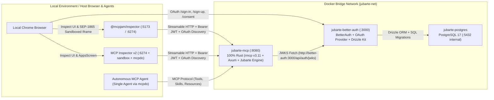

<!--
SPDX-FileCopyrightText: 2026 Jandira Technologies, LLC

SPDX-License-Identifier: Apache-2.0
-->

# Implementation Plan: Pure-Rust `jubarte-mcp` Server with BetterAuth + Drizzle OAuth & SEP-1865 MCP Apps

## Goal Description

Host **Jubarte** as a **100% native Rust Model Context Protocol (MCP) server** (`jubarte-mcp`) in its own Docker container, paired with a **separate BetterAuth + Drizzle Kit + PostgreSQL OAuth 2.1 Authorization Server container**. Users authenticate in the browser via OAuth 2.1 (Authorization Code + PKCE `S256`, supporting both Client ID Metadata Documents [CIMD] and Dynamic Client Registration [DCR]), receive isolated per-user `.docx` workspaces, and review or edit Word documents inside an interactive **SEP-1865 (`io.modelcontextprotocol/ui`) MCP App** (`ui://jubarte/document-studio.html`).

Through **SEP-1865 (`modelcontextprotocol/modelcontextprotocol#1865`)** and the five MCP Apps best practices (host context adaptation, model/view payload separation, loading/error states, keeping the model in the loop, and tool visibility partitioning), the user's AI agent has continuous visibility into the active `.docx` document in **Jubarte's Modified Markup Dialect ("Agent View")** — including YAML frontmatter (`source`, `sha256`, `view: tracked`, `authors`, `styles`, `headers`/`footers`), `<!-- page N of M -->` and `<!-- pN ... -->` coordinate anchors, CriticMarkup + brace attribution tags (`{++ins++}{r0 @AC}`, `{--del--}{r7 @AC}`, `{~~old~>new~~}{r2+1 @AC}`, `{==scope==}{>>c5 @AC: comment<<}`), highlights, Word fields, and OMML LaTeX math — via tool results (`content`), live background context sync (`ui/update-model-context`), active user triggers (`ui/message`), and introspectable App-Provided Tools (`app.registerTool` + WebMCP `document.modelContext`).

This design ignores the legacy stdio-only Python implementation (`jubarte-python/python/jubarte/mcp_server.py`) and implements the server natively in Rust on top of `rmcp` v3.11 and Jubarte's Rust engine crates.

---

## Architectural Decisions

1. **Standalone Cargo Workspace at `jubarte-mcp/`**:
   Root `Cargo.toml` (`members = [".", "crates/*"]`) locks the nine core crates published to crates.io with zero async/network dependencies and strict `multiple-versions = "deny"` across five target triples (`deny.toml`). Following the pattern of `jubarte-python/`, `jubarte-wasm/`, and `jubarte-rust-inproc/`, `jubarte-mcp/` sits as a standalone Cargo workspace (added to `[workspace].exclude` in root `Cargo.toml` and scanned in `scripts/security-check.sh`) linking directly to `jubarte = { path = "..", default-features = false }` and the split engine crates.
2. **Pure-Rust Runtime Container with Embedded Single-File SEP-1865 View**:
   `jubarte-mcp/ui/` (React 19 + `@modelcontextprotocol/ext-apps/react`) is bundled at Docker build time via Vite + `vite-plugin-singlefile` into a single self-contained HTML5 file (`dist/document-studio.html`) and embedded into the Rust binary via `include_str!`. The final `jubarte-mcp` container (`debian:bookworm-slim`, non-root user) runs only the native Rust binary and open-source renderer fonts — zero Node.js and zero Python at runtime.
3. **Separate BetterAuth + Drizzle Kit + PostgreSQL Container (`deploy/better-auth/`)**:
   Authentication runs in its own container backed by PostgreSQL 17 and `drizzle-orm` + `drizzle-kit` SQL migrations, exposing Email/Password sign-up & sign-in (plus optional GitHub/Google social OAuth), `/sign-in`, `/sign-up`, and `/consent` browser UIs, asymmetric JWKS (`/api/auth/jwks`), RFC 8414 & OIDC Discovery, PKCE `S256`, both CIMD (`SEP-991`) and DCR (`RFC 7591`), RFC 8707 `resource` audience binding, and RFC 9207 `iss` callback parameters.

---

## Multi-Container Topology & Protocol Flow

### Container Topology (`deploy/docker-compose.yml`)



### OAuth 2.1 + SEP-1865 Modified Markup Dialect Sequence

```mermaid
sequenceDiagram
  autonumber
  actor User as Human (Local Browser)
  participant Host as MCP Host / Inspector / Agent
  participant View as SEP-1865 View (ui://jubarte/document-studio.html)
  participant MCP as jubarte-mcp (Rust Container :8080)
  participant Auth as better-auth + Drizzle (Container :3000)
  participant DB as PostgreSQL (:5432)

  Host->>MCP: POST /mcp (unauthenticated initialize)
  MCP-->>Host: 401 Unauthorized + WWW-Authenticate: Bearer resource_metadata="http://localhost:8080/.well-known/oauth-protected-resource/mcp", scope="openid profile email jubarte:read jubarte:write"
  Host->>MCP: GET /.well-known/oauth-protected-resource/mcp
  MCP-->>Host: RFC 9728 Metadata (authorization_servers: ["http://localhost:3000/api/auth"])
  Host->>Auth: GET /.well-known/oauth-authorization-server/api/auth
  Auth-->>Host: RFC 8414 Metadata (PKCE S256, CIMD=true, DCR endpoint, JWKS, RFC 9207 iss=true)
  User->>Auth: Browser Authorize -> /sign-in (or /sign-up) -> /consent (Allow)
  Auth->>DB: Persist user, session, oauth_application, oauth_consent, jwks
  Auth-->>User: Redirect to callback with code + iss=http://localhost:3000/api/auth
  Host->>Auth: POST /api/auth/oauth2/token (code + code_verifier + resource)
  Auth-->>Host: Signed JWT (aud="http://localhost:8080/mcp", iss="http://localhost:3000/api/auth", sub, scope)

  Host->>MCP: POST /mcp initialize (capabilities.extensions["io.modelcontextprotocol/ui"])
  MCP->>Auth: Fetch & cache /api/auth/jwks
  MCP-->>Host: InitializeResult (tools, resources, prompts, extensions: ui + skills)
  Host->>MCP: resources/read { uri: "ui://jubarte/document-studio.html" }
  MCP-->>Host: HTML5 View (mimeType: "text/html;profile=mcp-app", _meta.ui.csp)

  Host->>MCP: tools/call docx_open { path: "revised.docx" }
  MCP-->>Host: CallToolResult { content: [Modified Markup Dialect], structuredContent: { pagesPng, paragraphs, changes, comments }, _meta: { sha256 } }
  Host->>View: ui/initialize -> McpUiInitializeResult (hostContext)
  View->>Host: ui/notifications/initialized
  Host-->>View: ui/notifications/tool-input + ui/notifications/tool-result

  User->>View: Clicks "Accept Change r2+1" in Studio UI
  View->>Host: tools/call ui_resolve_change (visibility: ["app"])
  Host->>MCP: tools/call ui_resolve_change
  MCP-->>View: Updated PNGs + Updated Modified Markup Dialect + New sha256
  View->>Host: ui/update-model-context { content: [{ type: "text", text: Updated Modified Markup Dialect }] }
  Host-->>View: {}
```

---

## Proposed File Layout & Changes

### 1. BetterAuth + Drizzle Kit Container (`deploy/better-auth/`)
- `deploy/better-auth/package.json` & `tsconfig.json`: Node 22 + Hono + `better-auth` + `@better-auth/oauth-provider` + `drizzle-orm` + `pg` + `drizzle-kit`.
- `deploy/better-auth/drizzle.config.ts` & `deploy/better-auth/src/db/schema.ts`: Complete PostgreSQL schema (`user`, `session`, `account`, `verification`, `jwks`, `oauthApplication`, `oauthAccessToken`, `oauthConsent`) and SQL migrations under `deploy/better-auth/drizzle/`.
- `deploy/better-auth/src/auth.ts` & `deploy/better-auth/src/cimd.ts`:
  - Email/Password sign-up & sign-in + optional GitHub/Google OAuth providers.
  - Asymmetric JWT signing (`/api/auth/jwks`) with RFC 8707 `aud` binding to `http://localhost:8080/mcp`.
  - Both **CIMD (`SEP-991`)** (`client_id_metadata_document_supported: true` + metadata fetch/validation/Drizzle sync) and **DCR (`RFC 7591`)** (rejecting non-loopback `http://` redirect URIs while supporting loopback `native` and HTTPS `web` clients).
  - All RFC 8414 & OIDC well-known discovery endpoints (root, path-inserted, and path-appended) + RFC 9207 `iss` authorization response parameter.
- `deploy/better-auth/src/server.ts` & `deploy/better-auth/src/views/`: Browser HTML UI for `/sign-in`, `/sign-up`, and `/consent`, plus `GET /healthz`.
- `deploy/better-auth/Dockerfile`: Non-root `node:22-bookworm-slim` container running Drizzle migrations before listening on `:3000`.

### 2. Pure-Rust `jubarte-mcp` Server (`jubarte-mcp/`)
- `Cargo.toml` & `scripts/security-check.sh`: Exclude `jubarte-mcp` from the lockstep 9-crate root workspace and include `jubarte-mcp/Cargo.toml` in security/deny checks.
- `jubarte-mcp/Cargo.toml`: Standalone workspace depending on `jubarte` engine crates + `rmcp` v3.11 (`server`, `macros`, `schemars`, `transport-streamable-http-server`, `transport-io`, `skills-fs`) + `axum` + `tokio` + `jsonwebtoken` + `reqwest` (`rustls-tls`) + `cap-std`.
- `jubarte-mcp/src/main.rs`: CLI supporting `jubarte-mcp serve` (Streamable HTTP + OAuth Resource Server) and `jubarte-mcp stdio --root <dir>` (local pure-Rust stdio mode).
- `jubarte-mcp/src/auth.rs`: RFC 9728 Protected Resource Metadata (`/.well-known/oauth-protected-resource` and `/.well-known/oauth-protected-resource/mcp`), JWKS cache & signature/issuer/audience validation, `401` Bearer challenges, and `403 insufficient_scope` step-up challenges.
- `jubarte-mcp/src/workspace.rs`: Per-user `cap-std` isolated tenant directories (`/data/workspaces/<tenant>/`), seeded on first login with starter `.docx` fixtures (`original.docx`, `revised.docx`, `sample-redline.docx`), enforcing atomic staging and input-admission budgets.
- `jubarte-mcp/src/dialect.rs`: `spawn_blocking` bridge into `jubarte-markdown`, `jubarte-doc`, `jubarte-edit`, `jubarte-redlines`, and `jubarte-render`, producing both Agent-View Modified Markup Dialect (`content`) and structured Studio payloads + rendered PNG pages (`structuredContent`, with ChatGPT Apps SDK token-safety awareness).
- `jubarte-mcp/src/resources.rs`, `jubarte-mcp/src/tools.rs`, `jubarte-mcp/src/server.rs`:
  - `ServerCapabilities` advertising `io.modelcontextprotocol/ui` (`text/html;profile=mcp-app`), `io.modelcontextprotocol/skills` (`SkillCatalog` serving `skills/jubarte-documents/SKILL.md`), `tools`, `resources`, `prompts`, and `logging`.
  - Predeclared `ui://jubarte/document-studio.html` resource with `_meta.ui` (`csp`, `permissions`, `prefersBorder`) on both `resources/list` and `resources/read`.
  - Full tool suite with strict `_meta.ui.visibility`:
    - `["model", "app"]`: `docx_workspace_list`, `docx_open`, `docx_text`, `docx_inspect`, `docx_edit`, `docx_compare`, `docx_changes`, `docx_comments`, `docx_accept`, `docx_reject`, `docx_render`, `docx_validate`, `docx_audit`, `docx_capabilities`.
    - `["app"]` (human UI-only): `ui_resolve_change`, `ui_manage_comment`, `ui_render_page`, `ui_upload_docx`, `ui_delete_file`.

### 3. SEP-1865 MCP App Studio View (`jubarte-mcp/ui/`)
- React 19 + `@modelcontextprotocol/ext-apps/react` single-file HTML bundle (`dist/document-studio.html`) embedded in `jubarte-mcp`:
  - Adapts to `hostContext` (`theme`, standardized CSS variables with `light-dark()` fallbacks, `fonts`, `locale`, `containerDimensions` + `ResizeObserver` `ui/notifications/size-changed`, `inline` / `fullscreen` display modes).
  - Dual-pane UI: Word-faithful rendered page PNG viewer + interactive **Jubarte Modified Markup Dialect** & Track-Changes/Comments inspector.
  - Skeleton loading, partial input preview, cancellation, and actionable error states.
  - **Live Agent Dialect Visibility**: Pushes updated **Modified Markup Dialect** (with `sha256` and active `<!-- pN -->` focus) via `ui/update-model-context` on every document load/accept/reject/comment/selection change, triggers active follow-ups via `ui/message`, and exposes read-only App Tools (`studio_get_live_dialect`, `studio_get_selection`) + WebMCP `document.modelContext`.

### 4. Docker Orchestration (`deploy/`)
- `jubarte-mcp/Dockerfile`: 3-stage build (`ui-builder` → `rust-builder` → minimal `debian:bookworm-slim` pure-Rust runtime).
- `deploy/docker-compose.yml` & `deploy/.env.example`: Separate `postgres`, `better-auth`, and `jubarte-mcp` containers with healthchecks and persistent volumes.

---

## Verification Matrix

1. **Repo Hygiene & Rust Tests**:
   - `python3 scripts/sync_license_files.py --check`
   - `cargo fmt --manifest-path jubarte-mcp/Cargo.toml --check`
   - `cargo clippy --manifest-path jubarte-mcp/Cargo.toml --all-targets -- -D warnings`
   - `cargo nextest run --manifest-path jubarte-mcp/Cargo.toml`
2. **Docker Multi-Container Stack**:
   - `docker compose -f deploy/docker-compose.yml up -d --build --wait` — verify all three containers (`postgres`, `better-auth`, `jubarte-mcp`) pass healthchecks and Drizzle migrations apply cleanly.
3. **Full Conformance & Inspection (`@mcpjam/inspector` + `inspector2`)**:
   - Run `@mcpjam/cli` conformance suites (`apps`, `oauth`, `protocol`) against the live Docker stack (7/7 `MCP_APPS_CHECK_IDS`, full OAuth negative/positive checks, Streamable HTTP checks).
   - Run `inspector2` CLI (`--app-info --advertise-apps`) and Web `AppsScreen` verification.
4. **Local Browser UI Verification (Real Chrome Browser — Zero API Shortcuts)**:
   - Drive real local Chrome via Playwright through `@mcpjam/inspector` and `inspector2` Web UIs: complete OAuth `/sign-up` → `/sign-in` → `/consent` via real HTML form interactions, render `ui://jubarte/document-studio.html` in the double-iframe sandbox, accept a tracked change in the UI (`ui_resolve_change`), verify `ui/update-model-context` updates the host's model context in Jubarte's Modified Markup Dialect, test Light & Dark themes, assert zero console/CSP errors, and capture screenshots.
5. **Single-Agent MCP Verification (Autonomous Subagent — Zero Raw API Calls)**:
   - Authenticate `mcpdo` via the local browser OAuth flow, then invoke one dedicated autonomous subagent (`self`) restricted strictly to MCP protocol calls via `mcpdo` to read the `jubarte-documents` skill, inspect documents in Jubarte's Modified Markup Dialect, compare versions, execute an atomic `docx_edit` redline plan, validate Ring-1 Word validity, resolve changes, render pages, and confirm `visibility: ["app"]` isolation.
