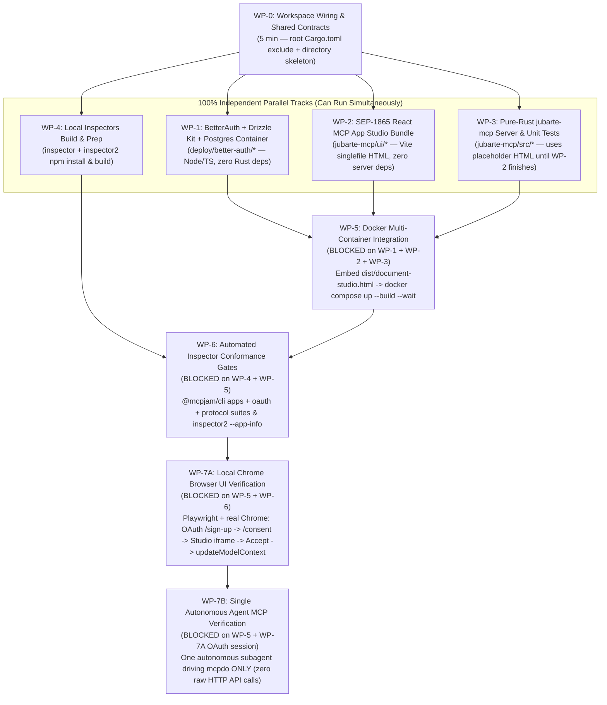

<!--
SPDX-FileCopyrightText: 2026 Jandira Technologies, LLC

SPDX-License-Identifier: Apache-2.0
-->

# Implementation Plan & Execution Runbook: Pure-Rust `jubarte-mcp` + BetterAuth/Drizzle OAuth + SEP-1865 MCP Apps

## Goal Description

Host **Jubarte** as a **100% native Rust Model Context Protocol (MCP) server** (`jubarte-mcp`) in its own Docker container, paired with a **separate BetterAuth + Drizzle Kit + PostgreSQL OAuth 2.1 Authorization Server container**. Users authenticate in the local browser via OAuth 2.1 (Authorization Code + PKCE `S256`, supporting both Client ID Metadata Documents [CIMD] and Dynamic Client Registration [DCR]), receive per-user sandboxed `.docx` workspaces, and review/edit Word documents inside an interactive **SEP-1865 (`io.modelcontextprotocol/ui`) MCP App** (`ui://jubarte/document-studio.html`).

Through **SEP-1865 (`modelcontextprotocol/modelcontextprotocol#1865`)** and MCPJam's five MCP Apps best practices, the user's AI agent maintains live visibility of the `.docx` document in **Jubarte's Modified Markup Dialect ("Agent View")** (`--- YAML frontmatter ---`, `<!-- page N of M -->`, `<!-- pN ... -->`, `{++ins++}{r0 @AC}`, `{--del--}{r7 @AC}`, `{~~old~>new~~}{r2+1 @AC}`, `{==scope==}{>>c5 @AC: comment<<}`, highlights, fields, and OMML LaTeX math) across tool results (`content`), background context updates (`ui/update-model-context`), active triggers (`ui/message`), and introspectable App-Provided Tools (`app.registerTool` + WebMCP `document.modelContext`).

> **Instructions for Implementing Agents (Including Smaller Models)**:
> 1. **Do NOT guess APIs**: Every Rust crate entry point, `rmcp` v3.11 type, and BetterAuth `1.7.6` option in this plan was verified directly against the local checkouts. Read the exact file and line range listed in **Source of Reference Materials** before creating each module.
> 2. **Ignore the legacy Python MCP server**: Do not edit or copy runtime architecture from `jubarte-python/python/jubarte/mcp_server.py`; only match its tool names/semantics where noted.
> 3. **Respect the Dependency Graph**: Work Packages `WP-1`, `WP-2`, `WP-3`, and `WP-4` are **100% independent** and can run in parallel; `WP-5`, `WP-6`, `WP-7A`, and `WP-7B` are **strictly sequential integration gates**.
> 4. **Follow Repo Hygiene on Every File & Commit**: Prepend the Apache-2.0 SPDX header to every new commentable file in `jubarte`, never add `#[allow(...)]` clippy suppressions, never commit high-entropy strings (`gitleaks`), run `cargo` commands sequentially per checkout, and sign off every commit with `git commit -s`.

---

## Source of Reference Materials (Authoritative Index)

| Topic / Component | Canonical Source (Repo Path or External Spec) | What to Extract from This Source |
| :--- | :--- | :--- |
| **SEP-1865 MCP Apps (PR #1865)** | `modelcontextprotocol/seps/1865-mcp-apps-interactive-user-interfaces-for-mcp.md`, `modelcontextprotocol/docs/extensions/apps/{overview,build}.mdx`, and `github.com/modelcontextprotocol/ext-apps` (`specification/2026-01-26/apps.mdx` & `specification/draft/apps.mdx`) | Extension ID `io.modelcontextprotocol/ui`, MIME `text/html;profile=mcp-app`, `ui://` scheme, `_meta.ui.{resourceUri, visibility}`, `_meta.ui.{csp, permissions, domain, prefersBorder}`, `ui/initialize`, `ui/update-model-context`, `ui/message`, `ui/request-display-mode`, `ui/notifications/size-changed`, App-Provided Tools & WebMCP bridging. |
| **MCPJam 5 Tips for MCP Apps** | MCPJam blog *5 Tips for Building MCP Apps That Work* + `inspector/mcpjam-inspector/client/src/components/chat-v2/thread/MCP_APPS_RENDERING.md` | Tip 1 (`hostContext` theme/locale/dimensions), Tip 2 (`content` vs `structuredContent` vs `_meta`, plus ChatGPT Apps SDK difference), Tip 3 (skeleton loading & `isError` states), Tip 4 (`sendMessage` vs `updateModelContext`), Tip 5 (`visibility: ["model" \| "app"]`). |
| **Jubarte Modified Markup Dialect** | `docs/DIALECT.md` (L1–191), `docs/MARKDOWN.md` (L1–610), `skills/jubarte-documents/SKILL.md` (L1–583) | Exact "Agent View" YAML frontmatter (`source`, `sha256`, `view`, `authors`, `styles`, `headers`/`footers`), `<!-- page N of M -->`, `<!-- pN ... -->`, `{++...++}{r0 @AC}`, `{--...--}{r7 @AC}`, `{~~...~>...~~}{r2+1 @AC}`, `{==...==}{>>c5 @AC: ...<<}`, `<mark>`, `{FIELD}...{/}`, `$...$` math, and JSON edit-plan rules. |
| **Jubarte Native Rust Engine APIs** | `src/lib.rs` (L13–160), `jubarte-python/src/lib.rs` (L1177–1206 & L1672–1740), `crates/jubarte-edit/src/publication.rs` (L177–232) | Exact Rust signatures: `jubarte::markdown::read`, `jubarte::inspect::inspect_json`, `jubarte::edit::apply_plan_json`, `jubarte::document_comparer::compare_documents`, `jubarte::changes::{list_changes, accept_changes, reject_changes}`, `jubarte::comments::list_comments`, `jubarte::validate::{validate, audit_tracked}`, `jubarte::audit::audit_report`, `jubarte::convert::{docx_to_png, docx_to_pdf_with}`, `jubarte::capabilities::capabilities_json`, `jubarte::publication::OutputRoot`. |
| **Jubarte Standalone Workspace & Repo Rules** | `AGENTS.md`, `Cargo.toml` (L10–15), `deny.toml` (L1–158), `jubarte-rust-inproc/Cargo.toml` (L1–37), `scripts/security-check.sh` (L1–38), `.github/workflows/dco.yml` | Standalone `[workspace]` pattern, SPDX Apache-2.0 header rules (`sync_license_files.py --check`), DCO sign-off (`check_dco.py`), `gitleaks` scan, `#![forbid(unsafe_code)]`, sequential Cargo rule, `RevisionStyle::Word` vs `Conventional`, and no inline comment icons. |
| **Rust MCP SDK (`rmcp` v3.11.0)** | `rust-sdk/examples/servers/src/{simple_auth_streamhttp,complex_auth_streamhttp,skills_stdio,structured_output}.rs`, `rust-sdk/crates/rmcp/src/model/{capabilities,resource,tool}.rs` | `StreamableHttpService`, `LocalSessionManager`, `StreamableHttpServerConfig`, Axum `Request::extensions` → `RequestContext<RoleServer>.extensions.get::<http::request::Parts>()`, `#[tool_router]`, `#[tool_handler]`, `SkillCatalog::from_dir`, `ResourceContents::text(...).with_mime_type(...).with_meta(...)`. |
| **MCP OAuth 2.1 & Streamable HTTP Specs** | `modelcontextprotocol/docs/specification/2026-07-28/basic/authorization/*.mdx`, `modelcontextprotocol/docs/specification/2025-11-25/basic/authorization.mdx` | Normative RFC 9728 PRM, RFC 8414 & OIDC path-inserted/appended discovery, CIMD vs DCR priority & `application_type`, PKCE `S256` requirement, RFC 8707 `resource` binding, `401`/`403` `WWW-Authenticate` challenges, RFC 9207 `iss` validation, SEP-2207 `offline_access` exclusion from PRM. |
| **BetterAuth 1.7 + OAuth Provider Reference** | `mcp-use/libraries/typescript/packages/server/examples/auth/mixed-oauth/src/{auth,index}.ts`, `mcp-oauth-better-auth-template/src/{server.ts,views/consent.tsx}` | `better-auth@1.7.6` + `@better-auth/oauth-provider@1.7.6` config (`resources`, `clientRegistrationDefaultResources`, `scopes`, `jwt()`), `/api/auth/oauth2/register` scope-ceiling wrapper, `/sign-in` and `/consent` POST contracts. |
| **Inspector Conformance & Local Execution** | `inspector/AGENTS.md`, `inspector/sdk/src/apps-conformance/ui-resource-content.ts`, `inspector/sdk/src/oauth-conformance/types.ts`, `inspector2/AGENTS.md`, `inspector2/clients/web/src/components/elements/AppRenderer/AppRenderer.tsx`, `inspector2/clients/mcpdo/README.md` | All 7 `MCP_APPS_CHECK_IDS`, all 14 `OAuthConformanceCheckId` checks, `@mcpjam/inspector` `dev:worktree` launch token flow, `inspector2` double-iframe `Origin: null` sandbox rules + `mcpdo` agent CLI commands. |

---

## Dependency Graph: What Can Be Done Independently vs. What Cannot



| Work Package | Can Run Independently? | Hard Prerequisites | Why / Isolation Boundary |
| :--- | :---: | :--- | :--- |
| **`WP-0`: Repo Wiring & Contracts** | Yes (Start first) | None | Freezes URLs, port map (`:5432`, `:3000`, `:8080`), scopes, and `Cargo.toml` exclusion in 5 minutes. |
| **`WP-1`: BetterAuth + Drizzle Container** | **Yes (Parallel)** | `WP-0` | Pure TypeScript/Postgres under `deploy/better-auth/`; verifiable standalone with Postgres + Drizzle migrate. |
| **`WP-2`: SEP-1865 React Studio UI** | **Yes (Parallel)** | `WP-0` | Pure frontend under `jubarte-mcp/ui/`; compiles standalone via Vite into `jubarte-mcp/ui/dist/document-studio.html`. |
| **`WP-3`: Pure-Rust `jubarte-mcp` Crate** | **Yes (Parallel)** | `WP-0` | Pure Rust under `jubarte-mcp/`; compiles & passes `cargo nextest` using a fallback HTML constant when `ui/dist/document-studio.html` is not built yet, and local test JWKS in tests. |
| **`WP-4`: Inspectors Install & Build** | **Yes (Parallel)** | None | Runs `npm install` / builds inside `inspector` and `inspector2` without touching `jubarte` or `cargo`. |
| **`WP-5`: Docker Compose Stack Bring-Up** | **No (Sequential)** | `WP-1`, `WP-2`, `WP-3` | Requires compiled `ui/dist/document-studio.html` embedded in `jubarte-mcp` image + `better-auth` image + `postgres`. |
| **`WP-6`: Conformance Suites (`inspector` & `inspector2`)** | **No (Sequential)** | `WP-4`, `WP-5` | Runs live conformance probes against the running `:3000` and `:8080` Docker containers. |
| **`WP-7A`: Local Browser UI Test (No API)** | **No (Sequential)** | `WP-5`, `WP-6` | Drives real Chrome against the live Inspector Web UIs + BetterAuth UI + Studio iframe. |
| **`WP-7B`: Single-Agent MCP Test (No API)** | **No (Sequential)** | `WP-5`, `WP-7A` | Uses an authenticated `mcpdo` session to let one autonomous subagent exercise the full Jubarte MCP workflow. |

---

## Pitfalls & Anti-Patterns Catalog (Read Before Coding)

1. **Pitfall 1 — Putting `jubarte-mcp` inside `crates/` breaks Jubarte's core workspace**:
   - *Cause*: Root `Cargo.toml` sets `members = [".", "crates/*"]` for the 9 lockstep crates published to crates.io and checks `multiple-versions = "deny"` across 5 OS/WASM triples in `deny.toml`. Adding `axum`/`tokio`/`rmcp` to `crates/` fails `deny.toml` and `release.sh`.
   - *Mitigation*: Put `[workspace]` at the top of `jubarte-mcp/Cargo.toml` (`publish = false`) and add `"jubarte-mcp"` to `[workspace].exclude` in root `Cargo.toml` (matching `jubarte-rust-inproc`).
2. **Pitfall 2 — Missing SPDX Header, Missing DCO Sign-off, Clippy `#[allow]`, or `gitleaks` Secret False Positives**:
   - *Cause*: `python3 scripts/sync_license_files.py --check` fails if any tracked file lacks `SPDX-License-Identifier: Apache-2.0` in its first 4 KiB; `python3 scripts/check_dco.py` fails if any commit lacks `Signed-off-by:`; `AGENTS.md` forbids `#[allow(...)]`; `gitleaks` in `scripts/security-check.sh` fails on high-entropy dummy secrets/JWTs.
   - *Mitigation*: Add the 3-line SPDX header to every new `.rs`, `.ts`, `.tsx`, `.css`, `.mjs`, `.sh`, `.yml`, `.toml`, and `.md` file; never write high-entropy hex/base64 secrets in committed files (generate runtime secrets in `.scratch/` or env); fix clippy warnings at the root cause; commit with `git commit -s`.
3. **Pitfall 3 — Running Parallel `cargo` Commands**:
   - *Cause*: Two concurrent `cargo` processes in `jubarte-mcp/` contend on `Cargo.lock`/build dir and time out (`AGENTS.md`).
   - *Mitigation*: Run `cargo fmt`, `cargo clippy`, `cargo nextest` strictly one after another. (Node `npm` builds in `deploy/better-auth` or `inspector` MAY run concurrently with `cargo`.)
4. **Pitfall 4 — BetterAuth `1.6` vs `1.7` Option & Table Schema Mismatch**:
   - *Cause*: `@better-auth/oauth-provider@1.7.6` uses `resources: [resource]` + `clientRegistrationDefaultResources: [resource]` (not `validAudiences`) and updated Drizzle table names (`oauthClient`, `oauthAccessToken`, `oauthRefreshToken`, `oauthConsent`, `jwks`).
   - *Mitigation*: Pin `better-auth@1.7.6` and `@better-auth/oauth-provider@1.7.6`. Generate `src/db/schema.ts` deterministically via `npx @better-auth/cli@1.7.6 generate --config src/auth.ts --output src/db/schema.ts --yes`, then generate SQL migrations via `npx drizzle-kit generate`. Never hand-guess BetterAuth column names.
5. **Pitfall 5 — BetterAuth Blocks Scope Step-Up Unless Client Registered with Full Scope Ceiling**:
   - *Cause*: BetterAuth rejects `/oauth2/authorize` if `scope` contains any scope the client did not include during `POST /api/auth/oauth2/register`.
   - *Mitigation*: Intercept `POST /api/auth/oauth2/register` before `auth.handler`, validate `redirect_uris`, and merge the full server scope ceiling (`"openid profile email offline_access jubarte:read jubarte:write"`) into `body.scope` while letting user consent determine per-token scopes.
6. **Pitfall 6 — Failing `oauth_dcr_http_redirect_uri` or BetterAuth Loopback `application_type` Check**:
   - *Cause*: `@mcpjam/sdk`'s `oauth_dcr_http_redirect_uri` sends a DCR request with `http://evil.example.com/callback` and expects HTTP `400`; meanwhile BetterAuth 1.7 rejects `http://127.0.0.1:...` redirect URIs when `application_type` defaults to `"web"` instead of `"native"`.
   - *Mitigation*: In the `POST /api/auth/oauth2/register` wrapper: (a) reject any `redirect_uris` entry that is malformed, contains fragments, or uses `http:` with a hostname other than `localhost`, `127.0.0.1`, or `[::1]` (`400` + `{"error":"invalid_redirect_uri"}`); (b) if all `redirect_uris` are loopback `http:` and `body.application_type` is omitted, set `application_type: "native"`.
7. **Pitfall 7 — Docker Split-Horizon URL Mismatch (`localhost` vs `better-auth` Service Name)**:
   - *Cause*: Inside Docker, `jubarte-mcp` cannot reach `http://localhost:3000/api/auth/jwks`, yet if BetterAuth sets `baseURL: "http://better-auth:3000"`, browser redirects and JWT `iss` claims break on the host browser.
   - *Mitigation*: Set BetterAuth's public `baseURL` to `http://localhost:3000` (`issuer` = `http://localhost:3000/api/auth`). Pass two separate env vars to `jubarte-mcp`: `AUTH_ISSUER=http://localhost:3000/api/auth` (used in RFC 9728 PRM `authorization_servers` and JWT `iss` verification) and `AUTH_JWKS_URL=http://better-auth:3000/api/auth/jwks` (used only for server-to-server JWKS fetch).
8. **Pitfall 8 — Path-Inserted Discovery 404s, Missing `iss` Param, or `offline_access` in PRM**:
   - *Cause*: Because BetterAuth's issuer has a path (`/api/auth`), RFC 8414 §3.1 clients probe `/.well-known/oauth-authorization-server/api/auth` while OIDC clients probe `/.well-known/openid-configuration/api/auth` and `/api/auth/.well-known/openid-configuration`. Also SEP-2207 forbids Protected Resources from advertising `offline_access` in PRM `scopes_supported` or `WWW-Authenticate`.
   - *Mitigation*: Mount all 6 `.well-known` routes on BetterAuth (with `Access-Control-Allow-Origin: *`), ensure `authorization_response_iss_parameter_supported: true` and append `iss=http://localhost:3000/api/auth` on `/api/auth/oauth2/authorize` & `/api/auth/oauth2/consent` redirect `Location` headers when absent, and advertise only `["openid", "profile", "email", "jubarte:read", "jubarte:write"]` on `jubarte-mcp`'s PRM (`/.well-known/oauth-protected-resource` AND `/.well-known/oauth-protected-resource/mcp`).
9. **Pitfall 9 — Returning `500` Instead of `401`/`404` on Bad Token or Unknown `Mcp-Session-Id`**:
   - *Cause*: `@mcpjam/sdk` tests `oauth_unauthenticated_challenge`, `oauth_resource_metadata_challenge`, `oauth_invalid_token`, and `oauth_stale_session_rejection`.
   - *Mitigation*: Always return `401` with `WWW-Authenticate: Bearer resource_metadata="http://localhost:8080/.well-known/oauth-protected-resource/mcp", scope="..."` (absolute URL!) on missing/invalid tokens, and ensure `rmcp`'s `StreamableHttpService` returns `404 Not Found` (4xx) on an unknown `Mcp-Session-Id` header.
10. **Pitfall 10 — Emitting Deprecated `_meta["ui/resourceUri"]` or Malformed `_meta.ui`**:
    - *Cause*: `@mcpjam/sdk` warns on `_meta["ui/resourceUri"]` and requires `resources/read` to return **exactly 1** content item with `mimeType === "text/html;profile=mcp-app"`, `text` starting with `<!DOCTYPE html>`, and `_meta.ui.permissions` values as empty objects `{}` (only `camera`, `microphone`, `geolocation`, `clipboardWrite`).
    - *Mitigation*: Use ONLY nested `_meta: { "ui": { "resourceUri": "ui://jubarte/document-studio.html", "visibility": [...] } }` on tools, and attach identical `_meta: { "ui": { "csp": { "connectDomains": [], "resourceDomains": [], "frameDomains": [], "baseUriDomains": [] }, "permissions": { "clipboardWrite": {} }, "prefersBorder": true } }` on **both** `resources/list` and `resources/read` `contents[0]`.
11. **Pitfall 11 — Calling `localStorage` or Loading External Fonts/Scripts Inside the Sandboxed View**:
    - *Cause*: `inspector2`'s `sandbox_proxy.html` strips `allow-same-origin` (`Origin: null`) and enforces `default-src 'none'; connect-src 'none'`. Calling `window.localStorage` throws `SecurityError` and crashes React mount.
    - *Mitigation*: Bundle 100% of JS and CSS inline via `vite-plugin-singlefile`, use zero external URLs/fonts, and never access `localStorage`, `sessionStorage`, or `document.cookie` without a `try/catch` in-memory fallback.
12. **Pitfall 12 — Crashing in `inspector2` When Calling `app.updateModelContext(...)`**:
    - *Cause*: `@mcpjam/inspector` implements `bridge.onupdatemodelcontext`, whereas `inspector2` Web (`AppRenderer.tsx`) omits `updateModelContext` because it has no LLM chat host.
    - *Mitigation*: Wrap `await app.updateModelContext(...)` in `try { ... } catch { ... }` inside `jubarte-mcp/ui` so `-32601` cleanly updates the UI badge to `"Host: Inspector Mode (View-only)"` with zero console errors.
13. **Pitfall 13 — Flooding ChatGPT Model Context with Base64 PNGs in `structuredContent` (MCPJam Tip 2)**:
    - *Cause*: Standard MCP Apps keep `structuredContent` out of model context, but ChatGPT Apps SDK sends `structuredContent` to both model and View.
    - *Mitigation*: Check `peer_info().client_info.name` in `jubarte-mcp`; if it contains `"chatgpt"` / `"openai"`, omit `renderedPages` base64 PNGs from `structuredContent` and let the View lazy-load page PNGs via `ui_render_page` (`visibility: ["app"]`).
14. **Pitfall 14 — Blocking Tokio Worker Threads with Synchronous Jubarte Engine Calls**:
    - *Cause*: `jubarte::markdown::read`, `apply_plan_json`, `compare_documents`, and `docx_to_png` do synchronous CPU work.
    - *Mitigation*: Execute every Jubarte engine and `OutputRoot` I/O call inside `tokio::task::spawn_blocking(move || ...).await`.
15. **Pitfall 15 — Hand-Synthesizing Dialect Markup or Enabling Inline Comment Icons**:
    - *Cause*: Hand-formatted Markdown drifts from `jubarte::edit`'s `pN`/`rN`/`sha256` parser; inline PDF comment icons violate `AGENTS.md` ("NEVER add a comment icon inline").
    - *Mitigation*: Always generate dialect text via `jubarte::markdown::read(bytes, &ReadOptions { ... })` and leave `PdfOptions::comment_notes = false`.
16. **Pitfall 16 — Violating the Browser-Only UI / Single-Agent MCP Testing Rule**:
    - *Cause*: Using `curl` to `POST /api/auth/sign-in/email` or `POST /mcp` skips real OAuth redirect/CORS/iframe/agent behavior.
    - *Mitigation*: Drive `/sign-up`, `/sign-in`, `/consent`, and the MCP App Studio iframe strictly via local Chrome (`Playwright`), and run the MCP functional workflow strictly via **one** autonomous subagent using `mcpdo`.

---

## Step-by-Step Work Packages, Checklists, & Acceptance Criteria

### `WP-0` — Workspace Wiring & Shared Constants (Sequential Prerequisite — ~5 min)

#### Files
- `[MODIFY]` `Cargo.toml`
- `[MODIFY]` `scripts/security-check.sh`
- `[MODIFY]` `.gitignore`

#### Checklist
- [ ] Update line 13 of `Cargo.toml` to add `"jubarte-mcp"` to `[workspace].exclude`:
  `exclude = ["jubarte-python", "jubarte-wasm", "jubarte-rust-inproc", "jubarte-mcp", "fuzz"]`
- [ ] Add `jubarte-mcp/Cargo.toml` to the manifest loop on line 10 of `scripts/security-check.sh` (guarded or alongside `WP-3`).
- [ ] Add `jubarte-mcp/target/`, `jubarte-mcp/ui/node_modules/`, `jubarte-mcp/ui/dist/`, `deploy/better-auth/node_modules/`, and `deploy/better-auth/dist/` to `.gitignore`.
- [ ] Freeze canonical URLs & scopes across all packages:
  - Public Auth Origin: `http://localhost:3000` | Issuer: `http://localhost:3000/api/auth`
  - Internal Docker JWKS URL: `http://better-auth:3000/api/auth/jwks`
  - Public MCP Endpoint & RFC 8707 Resource URI: `http://localhost:8080/mcp`
  - Public PRM URL: `http://localhost:8080/.well-known/oauth-protected-resource/mcp`
  - UI Resource URI: `ui://jubarte/document-studio.html` | MIME: `text/html;profile=mcp-app`
  - Scopes: `openid`, `profile`, `email`, `offline_access` (AS only), `jubarte:read`, `jubarte:write`

#### Acceptance Criteria (`AC-0`)
- [ ] `AC-0.1`: `python3 scripts/sync_license_files.py --check` exits `0`.
- [ ] `AC-0.2`: `cargo metadata --no-deps --format-version 1 | jq -r '.workspace_members[]'` lists only the 9 existing engine crates.

---

### `WP-1` — Separate BetterAuth + Drizzle Kit + PostgreSQL Container (`deploy/better-auth/`) [Independent / Parallel]

#### Files
- `[NEW]` `deploy/better-auth/package.json`
- `[NEW]` `deploy/better-auth/tsconfig.json`
- `[NEW]` `deploy/better-auth/drizzle.config.ts`
- `[NEW]` `deploy/better-auth/src/db/index.ts`
- `[NEW]` `deploy/better-auth/src/db/schema.ts` *(generated via `@better-auth/cli`)*
- `[NEW]` `deploy/better-auth/drizzle/*` *(generated SQL migrations via `drizzle-kit generate`)*
- `[NEW]` `deploy/better-auth/src/auth.ts`
- `[NEW]` `deploy/better-auth/src/cimd.ts`
- `[NEW]` `deploy/better-auth/src/views.ts`
- `[NEW]` `deploy/better-auth/src/server.ts`
- `[NEW]` `deploy/better-auth/Dockerfile`

#### Implementation Blueprint
```ts
// deploy/better-auth/src/auth.ts (SPDX header required at top of file)
import { betterAuth } from "better-auth";
import { drizzleAdapter } from "better-auth/adapters/drizzle";
import { jwt } from "better-auth/plugins";
import { oauthProvider } from "@better-auth/oauth-provider";
import { db } from "./db/index.js";
import * as schema from "./db/schema.js";

export const SERVER_SCOPES = [
  "openid",
  "profile",
  "email",
  "offline_access",
  "jubarte:read",
  "jubarte:write",
] as const;

const authOrigin = process.env.AUTH_PUBLIC_ORIGIN ?? "http://localhost:3000";
const mcpResource = process.env.MCP_RESOURCE_URL ?? "http://localhost:8080/mcp";

export const auth = betterAuth({
  database: drizzleAdapter(db, { provider: "pg", schema }),
  baseURL: authOrigin,
  basePath: "/api/auth",
  secret: process.env.BETTER_AUTH_SECRET,
  emailAndPassword: { enabled: true, autoSignIn: true },
  trustedOrigins: [
    authOrigin,
    "http://127.0.0.1:3000",
    "http://localhost:5173",
    "http://127.0.0.1:5173",
    "http://localhost:6274",
    "http://127.0.0.1:6274",
  ],
  plugins: [
    jwt(),
    oauthProvider({
      loginPage: "/sign-in",
      consentPage: "/consent",
      scopes: [...SERVER_SCOPES],
      clientRegistrationDefaultScopes: [...SERVER_SCOPES],
      clientRegistrationAllowedScopes: [...SERVER_SCOPES],
      allowDynamicClientRegistration: true,
      allowUnauthenticatedClientRegistration: true,
      resources: [mcpResource],
      clientRegistrationDefaultResources: [mcpResource],
      customAccessTokenClaims: ({ user }) => ({
        email: user?.email,
        name: user?.name,
      }),
      silenceWarnings: { oauthAuthServerConfig: true },
    }),
  ],
});
```

#### Checklist
- [ ] Create `deploy/better-auth/package.json` (`"type": "module"`, pinning `better-auth: "1.7.6"`, `@better-auth/oauth-provider: "1.7.6"`, `drizzle-orm: "^0.44.0"`, `pg: "^8.16.0"`, `hono: "^4.11.0"`, `@hono/node-server: "^1.19.0"`, devDependencies `@better-auth/cli: "1.7.6"`, `drizzle-kit: "^0.31.0"`, `@types/pg`, `tsx`, `typescript`) and run `npm install`.
- [ ] Create `src/db/index.ts` and initial `src/auth.ts`, then run:
  `npx @better-auth/cli@1.7.6 generate --config src/auth.ts --output src/db/schema.ts --yes`
  Prepend the Apache-2.0 SPDX header to `src/db/schema.ts`, wire `schema` into `drizzleAdapter(db, { provider: "pg", schema })`, and run `npx drizzle-kit generate` to create deterministic SQL migrations in `deploy/better-auth/drizzle/` (prepend SPDX SQL comment header to generated `.sql` files).
- [ ] Implement `src/cimd.ts` advertising `"client_id_metadata_document_supported": true`, `"code_challenge_methods_supported": ["S256"]`, and `"authorization_response_iss_parameter_supported": true`, plus middleware on `GET /api/auth/oauth2/authorize` that fetches/validates URL-shaped `client_id` metadata documents (with SSRF guard allowing dev loopback) and upserts them into Drizzle's `oauthClient` table.
- [ ] Implement `POST /api/auth/oauth2/register` wrapper in `src/server.ts` rejecting non-loopback `http://` `redirect_uris` with `400 invalid_redirect_uri`, defaulting loopback `application_type` to `"native"`, and merging `SERVER_SCOPES.join(" ")` into registered client scopes.
- [ ] Mount all 6 `.well-known` discovery endpoints with `Access-Control-Allow-Origin: *`, and append `iss=http://localhost:3000/api/auth` on authorize/consent redirect `Location` headers when absent (RFC 9207).
- [ ] Implement accessible HTML browser pages in `src/views.ts` (`GET /sign-in`, `GET /sign-up`, `GET /consent`) with explicit `data-testid` attributes (`signup-name`, `signup-email`, `signup-password`, `signup-submit`, `signin-email`, `signin-password`, `signin-submit`, `goto-signup`, `consent-allow`, `consent-deny`).
- [ ] Run Drizzle `migrate()` programmatically on server startup, expose `GET /healthz` (`SELECT 1`), and write `deploy/better-auth/Dockerfile` (`node:22-bookworm-slim`, non-root `node` user, port `3000`).

#### Acceptance Criteria (`AC-1`)
- [ ] `AC-1.1`: `npm --prefix deploy/better-auth run build` compiles with zero TypeScript errors.
- [ ] `AC-1.2`: `deploy/better-auth/drizzle/` contains generated SQL migrations creating BetterAuth user, session, account, verification, jwks, and oauth tables.
- [ ] `AC-1.3`: Starting Postgres + `better-auth` applies Drizzle migrations cleanly, `GET /healthz` returns `200`, all 6 `.well-known` discovery URLs return `200` with `"issuer": "http://localhost:3000/api/auth"`, `"code_challenge_methods_supported": ["S256"]`, `"client_id_metadata_document_supported": true`, and `POST /api/auth/oauth2/register` rejects `http://evil.example.com/cb` with `400` while accepting `http://127.0.0.1:6276/oauth/callback` with `201`/`200`.

---

### `WP-2` — SEP-1865 React MCP App View (`jubarte-mcp/ui/`) [Independent / Parallel]

#### Files
- `[NEW]` `jubarte-mcp/ui/package.json`
- `[NEW]` `jubarte-mcp/ui/tsconfig.json`
- `[NEW]` `jubarte-mcp/ui/vite.config.ts`
- `[NEW]` `jubarte-mcp/ui/index.html`
- `[NEW]` `jubarte-mcp/ui/src/types.ts`
- `[NEW]` `jubarte-mcp/ui/src/styles.css`
- `[NEW]` `jubarte-mcp/ui/src/components/DialectViewer.tsx`
- `[NEW]` `jubarte-mcp/ui/src/components/PageCanvas.tsx`
- `[NEW]` `jubarte-mcp/ui/src/App.tsx`
- `[NEW]` `jubarte-mcp/ui/src/main.tsx`

#### Checklist
- [ ] Configure `jubarte-mcp/ui/package.json` with `@modelcontextprotocol/ext-apps`, `react: "^19.0.0"`, `react-dom: "^19.0.0"`, `vite`, `@vitejs/plugin-react`, and `vite-plugin-singlefile` so `npm run build` outputs a single inline HTML file at `jubarte-mcp/ui/dist/document-studio.html` with zero external asset URLs.
- [ ] Implement **MCPJam Tip 1 (Host Context & Theme)**: apply `hostContext` (`theme`, standardized CSS variables with `light-dark()` defaults, `fonts`, `locale`, `containerDimensions` + `ResizeObserver` `ui/notifications/size-changed`, and `Inline / Fullscreen` toggle via `app.requestDisplayMode`).
- [ ] Implement **MCPJam Tip 2 & 3 (Loading, Partial Input, Error, & Dual-Pane Studio)**:
  - Skeleton loading (`data-testid="studio-loading"`), partial input filename preview, and actionable error banner (`data-testid="studio-error"`).
  - Left pane (`PageCanvas.tsx`): Word-faithful rendered page PNG viewer + `Conventional` vs `Word` revision-style switcher calling `ui_render_page` (`visibility: ["app"]`).
  - Right pane (`DialectViewer.tsx`): interactive syntax-highlighted **Modified Markup Dialect** (`data-testid="tab-dialect"`, clickable `<!-- pN -->` chips) + Track Changes & Comments tab (`data-testid="tab-changes"`, per-revision **Accept** `data-testid="accept-change-<id>"` and **Reject** `data-testid="reject-change-<id>"` calling `ui_resolve_change`, and comment controls calling `ui_manage_comment`).
- [ ] Implement **MCPJam Tip 4 & SEP-1865 Agent Visibility**:
  - Push live **Modified Markup Dialect** (prefixed with `<!-- studio_focus: file=..., sha256=..., page=..., selected_paragraph=... -->`) via `app.updateModelContext(...)` wrapped in `try/catch` (Pitfall 12), updating `data-testid="model-context-sync-badge"`.
  - Provide `data-testid="ask-agent-btn"` calling `app.sendMessage(...)` (`ui/message`) with the focused paragraph's exact `<!-- pN -->` dialect snippet.
  - Register read-only App Tools (`studio_get_live_dialect`, `studio_get_selection`) when supported by the SDK `App` instance.

#### Acceptance Criteria (`AC-2`)
- [ ] `AC-2.1`: `npm --prefix jubarte-mcp/ui run build` exits `0` and produces `jubarte-mcp/ui/dist/document-studio.html`.
- [ ] `AC-2.2`: `jubarte-mcp/ui/dist/document-studio.html` starts with `<!doctype html>` (case-insensitive), contains zero external `http://` or `https://` `<script>`/`<link>`/`` URLs, and contains zero unguarded `localStorage` accesses.

---

### `WP-3` — Pure-Rust `jubarte-mcp` Server (`jubarte-mcp/`) [Independent / Parallel]

#### Files
- `[NEW]` `jubarte-mcp/Cargo.toml`
- `[NEW]` `jubarte-mcp/src/main.rs`
- `[NEW]` `jubarte-mcp/src/lib.rs`
- `[NEW]` `jubarte-mcp/src/auth.rs`
- `[NEW]` `jubarte-mcp/src/workspace.rs`
- `[NEW]` `jubarte-mcp/src/dialect.rs`
- `[NEW]` `jubarte-mcp/src/resources.rs`
- `[NEW]` `jubarte-mcp/src/tools.rs`
- `[NEW]` `jubarte-mcp/src/server.rs`
- `[NEW]` `jubarte-mcp/tests/mcp_integration.rs`

#### Verified Rust Engine & `rmcp` Blueprint
```rust
// Capability-confined tenant root & Modified Markup Dialect ("Agent View"):
let root = jubarte::publication::OutputRoot::open(&tenant_dir)?;
let docx_bytes: Vec<u8> = root.read(std::path::Path::new(&rel_path))?;
let options = jubarte::markdown::ReadOptions {
    track_changes: jubarte::markdown::TrackChanges::Tracked,
    comments: true,
    dates: true,
    page_markers: true,
    select: jubarte::markdown::Select::default(),
    source: Some(file_name.to_string()),
};
let view = jubarte::markdown::read(&docx_bytes, &options)?;

// ServerCapabilities with SEP-1865 UI + SEP-2640 Skills:
let mut extensions = rmcp::model::ExtensionCapabilities::new();
extensions.insert(
    "io.modelcontextprotocol/ui".to_string(),
    serde_json::json!({ "mimeTypes": ["text/html;profile=mcp-app"] })
        .as_object()
        .cloned()
        .unwrap_or_default(),
);
let capabilities = rmcp::model::ServerCapabilities::builder()
    .enable_tools()
    .enable_tool_list_changed()
    .enable_resources()
    .enable_resource_list_changed()
    .enable_prompts()
    .enable_logging()
    .enable_skills_with_directory_read()
    .enable_extensions_with(extensions)
    .build();
```

#### Checklist
- [ ] Create `jubarte-mcp/Cargo.toml` (`[workspace]`, `#![forbid(unsafe_code)]`, `publish = false`, `license = "Apache-2.0"`, `edition = "2024"`) depending on `jubarte = { path = "..", default-features = false }`, `rmcp = { version = "3.11", features = ["server", "macros", "schemars", "transport-streamable-http-server", "transport-io", "skills-fs"] }`, `axum = "0.8"`, `tower = "0.5"`, `tower-http = { version = "0.6", features = ["cors", "trace"] }`, `tokio = { version = "1", features = ["full"] }`, `jsonwebtoken = "9"`, `reqwest = { version = "0.12", default-features = false, features = ["json", "rustls-tls"] }`, `clap = { version = "4", features = ["derive", "env"] }`, `serde`, `serde_json`, `schemars = "1"`, `sha2 = "0.11"`, `base64 = "0.23"`, `tracing`, `tracing-subscriber`.
- [ ] Implement `src/auth.rs` serving RFC 9728 PRM at `/.well-known/oauth-protected-resource` and `/.well-known/oauth-protected-resource/mcp`, caching/refreshing JWKS (`EdDSA`, `RS256`, `ES256`), enforcing `iss == AUTH_ISSUER` and RFC 8707 `aud` containing `PUBLIC_MCP_URL`, returning `401` + absolute `resource_metadata` `WWW-Authenticate` on missing/invalid tokens, and injecting `AuthenticatedUser` into `Request::extensions`.
- [ ] Implement `src/workspace.rs` mapping each `user.sub` to `/data/workspaces/<sha256-sub>/` via `jubarte::publication::OutputRoot`, seeding `original.docx`, `revised.docx`, and `sample-redline.docx` on first login.
- [ ] Implement `src/dialect.rs`, `src/resources.rs`, `src/tools.rs`, and `src/server.rs` using `tokio::task::spawn_blocking`, `SkillCatalog::from_dir` (`skills/jubarte-documents`), guided prompts, predeclared `ui://jubarte/document-studio.html` (with identical `_meta.ui` on `resources/list` and `resources/read`), and all tools with nested `_meta.ui.resourceUri` + `_meta.ui.visibility` (`docx_workspace_list`, `docx_open`, `auth_whoami`, `docx_text`, `docx_inspect`, `docx_edit`, `docx_compare`, `docx_changes`, `docx_comments`, `docx_accept`, `docx_reject`, `docx_render`, `docx_validate`, `docx_audit`, `docx_capabilities`, plus `visibility: ["app"]` `ui_resolve_change`, `ui_manage_comment`, `ui_render_page`, `ui_upload_docx`, `ui_delete_file`).
- [ ] Write integration tests in `jubarte-mcp/tests/mcp_integration.rs` testing `401` challenges, wrong-audience rejection, valid JWT access, cross-user workspace isolation, `skills/list`, `resources/read` (`ui://...`), `docx_open` Modified Markup Dialect + `structuredContent`, `docx_edit`, and `404` on unknown `Mcp-Session-Id`.

#### Acceptance Criteria (`AC-3`)
- [ ] `AC-3.1`: `cargo fmt --manifest-path jubarte-mcp/Cargo.toml --check` exits `0`.
- [ ] `AC-3.2`: `cargo clippy --manifest-path jubarte-mcp/Cargo.toml --all-targets -- -D warnings` exits `0` with zero `#[allow(...)]` attributes.
- [ ] `AC-3.3`: `cargo nextest run --manifest-path jubarte-mcp/Cargo.toml` passes 100% of unit and integration tests.
- [ ] `AC-3.4`: `cargo run --manifest-path jubarte-mcp/Cargo.toml -- --help` exits `0`.

---

### `WP-4` — Local Inspectors Build & Preparation [Independent / Parallel]

#### Checklist
- [ ] In `inspector`, run `npm install --legacy-peer-deps && npm run build:packages`.
- [ ] In `inspector2`, run `npm install && npm run build`.
- [ ] Confirm `git status --porcelain` in both `inspector` and `inspector2` is empty.

#### Acceptance Criteria (`AC-4`)
- [ ] `AC-4.1`: `node inspector/cli/dist/index.js --help` exits `0`.
- [ ] `AC-4.2`: `node inspector2/clients/launcher/build/index.js --cli --help` and `node inspector2/clients/mcpdo/build/mcp-bin.js --help` exit `0`.

---

### `WP-5` — Multi-Container Docker Compose Build & Hosting [Sequential — Blocked on `WP-1`, `WP-2`, `WP-3`]

#### Files
- `[NEW]` `.dockerignore`
- `[NEW]` `jubarte-mcp/Dockerfile`
- `[NEW]` `deploy/docker-compose.yml`
- `[NEW]` `deploy/.env.example`

#### Checklist
- [ ] Create `.dockerignore` excluding `.git`, `target`, `**/node_modules`, `.scratch`, `tests/corpus`, `release_info`.
- [ ] Create 3-stage `jubarte-mcp/Dockerfile` (`ui-builder` → `rust-builder` → minimal `debian:bookworm-slim` non-root pure-Rust runtime with zero Node/Python).
- [ ] Create `deploy/docker-compose.yml` + `deploy/.env.example` orchestrating separate `postgres`, `better-auth` (`:3000`), and `jubarte-mcp` (`:8080`) containers with healthchecks and named volumes.
- [ ] Generate runtime `.scratch/docker.env` and bring up `docker compose --env-file .scratch/docker.env -f deploy/docker-compose.yml up -d --build --wait`.

#### Acceptance Criteria (`AC-5`)
- [ ] `AC-5.1`: All three containers (`postgres`, `better-auth`, `jubarte-mcp`) report `running` and `healthy`.
- [ ] `AC-5.2`: `which node python3` inside `jubarte-mcp` container returns non-zero (pure-Rust runtime verified).
- [ ] `AC-5.3`: PostgreSQL inside `postgres` contains all migrated Drizzle tables.

---

### `WP-6` — Full Specification Inspection via Both Mounted Inspectors [Sequential — Blocked on `WP-4`, `WP-5`]

#### Checklist
- [ ] Run `@mcpjam/cli` OAuth Conformance Suite (`dcr` + `cimd` + negative security checks) against `http://localhost:8080/mcp`.
- [ ] Run `@mcpjam/cli` `apps conformance` and `conformance run` (`protocol` + `apps`) against `http://localhost:8080/mcp`.
- [ ] Run `inspector2` `--cli --app-info --advertise-apps` and verify `skills/list` + `resources/list` + `tools/list`.

#### Acceptance Criteria (`AC-6`)
- [ ] `AC-6.1`: `@mcpjam/cli` MCP Apps Conformance passes **7/7** `MCP_APPS_CHECK_IDS` with **0** deprecation warnings.
- [ ] `AC-6.2`: `@mcpjam/cli` OAuth & Protocol conformance suites pass with **0** failed checks.
- [ ] `AC-6.3`: `inspector2` `--app-info --advertise-apps` validates `ui://jubarte/document-studio.html` and `skills/list` exposes `jubarte-documents`.

---

### `WP-7A` — Local Browser UI Verification (Strictly via Local Chrome — Zero API Shortcuts) [Sequential — Blocked on `WP-5`, `WP-6`]

#### Checklist
- [ ] Launch `@mcpjam/inspector` (`dev:worktree -- 0 --no-worker`) and `inspector2` Web UI (`CLIENT_PORT=6284`).
- [ ] Drive real local Chrome via Playwright through DOM interactions only:
  - [ ] Connect `http://localhost:8080/mcp` in `@mcpjam/inspector` → follow browser redirect to `http://localhost:3000/sign-in` → click `goto-signup` → submit HTML `/sign-up` form → click `consent-allow` on `/consent` → confirm Inspector transitions to **Connected**.
  - [ ] Run `docx_open` (`sample-redline.docx`), verify the double-iframe sandbox renders both the Word-faithful page PNG and the **Modified Markup Dialect** (`<!-- pN -->`, `{++...++}`, `{--...--}`).
  - [ ] Click **Accept** on a revision inside the Studio iframe (`ui_resolve_change`, `visibility: ["app"]`) and verify `ui/update-model-context` updates `@mcpjam/inspector`'s Host Model Context with the updated **Modified Markup Dialect** and fresh `sha256`.
  - [ ] Capture Light Mode & Dark Mode screenshots in `@mcpjam/inspector` plus `AppsScreen` in `inspector2`.

#### Acceptance Criteria (`AC-7A`)
- [ ] `AC-7A.1`: Complete OAuth sign-up, consent, and Studio interaction executed strictly through local Chrome DOM actions (zero API shortcuts).
- [ ] `AC-7A.2`: Zero `console.error`, zero `pageerror`, and zero CSP violations across both Inspector UIs.
- [ ] `AC-7A.3`: Host Model Context contains the post-Accept **Modified Markup Dialect**, with Light & Dark screenshots saved.

---

### `WP-7B` — Single Autonomous Agent MCP Verification (Zero Raw API Calls) [Sequential — Blocked on `WP-5`, `WP-7A`]

#### Checklist
- [ ] Connect `mcpdo` (`connect http://localhost:8080/mcp`) and complete the `authUrl` login/consent in local Chrome.
- [ ] Invoke **one** autonomous subagent restricted strictly to `mcpdo` MCP commands (forbidding raw HTTP/`curl` calls and direct workspace filesystem access) to:
  - [ ] Discover capabilities, fetch the `jubarte-documents` skill (`skills/list` → `skills/get`), and list workspace files (`docx_workspace_list`).
  - [ ] Read `original.docx` and `revised.docx` in **Modified Markup Dialect**, compare them (`docx_compare`), inspect changes (`docx_changes`), apply an atomic `docx_edit` JSON plan anchored on exact `<!-- pN -->` IDs and `source_sha256`, validate Ring-1 Word validity (`docx_validate`), accept a change (`docx_accept`), render PNG/PDF (`docx_render`), and verify `visibility: ["app"]` isolation.
- [ ] Run `python3 scripts/sync_license_files.py --check`, `git diff --check`, and `python3 scripts/check_dco.py main HEAD`, commit & push, and publish `walkthrough.md`.

#### Acceptance Criteria (`AC-7B`)
- [ ] `AC-7B.1`: The autonomous agent completes the full document redline lifecycle exclusively via `mcpdo` MCP protocol calls with **0** `word_fatal` findings in `docx_validate`.
- [ ] `AC-7B.2`: All repo hygiene, license, and DCO checks exit `0`, and changes are pushed to `origin/feat/jubarte-mcp-rust-oauth-apps`.
